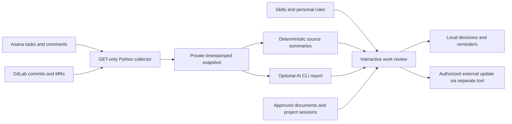

# Architecture

## Responsibilities

- `workbrain/clients.py`: HTTPS GET requests, bounded retries, pagination, nested
  subtasks. Redirects are rejected to avoid forwarding credentials.
- `workbrain/collect.py`: one normalized snapshot of all configured active sources.
  API collection failure aborts before replacing the previous snapshot.
- `workbrain/reports.py`: deterministic source summaries. It does not infer priority
  or deployment from counts. All configured focus projects stay visible.
- `workbrain/runner.py`: optional generation through an installed Codex or Claude
  CLI. Receives a supplied snapshot and preserves the old report on failure.
- `workbrain/cli.py`: initialization, refresh, report generation, and schedule-file generation.
- `.agents/skills/`: decision procedures for interactive work. Claude command files
  point to the same procedures so the workflows do not fork into two copies.
- `AGENTS.md`: general boundaries. `projects/operating-rules.md` holds your private preferences.

## Sources of truth

Asana describes ownership, intent, and commitments. GitLab describes engineering
activity. Neither proves customer acceptance by itself. Brain keeps dated local
decisions and links back to the source that supports each conclusion.

Refresh writes `.brain/snapshot.json` and `PORTFOLIO.md`. Reports have two layers:
`*.source.md` contains collected facts; `*.md` contains contextual decisions. A
normal scheduled refresh never overwrites an interactive report. Opting into an
AI report explicitly replaces that date's report after validating its basic format.

## Reliability boundaries

Private files are written with mode 0600 using temporary files and atomic rename.
A process-held `flock` serializes refresh/report runs and releases automatically
when the process exits. The lock inode is intentionally retained; its existence
does not mean a process is running. Do not remove it during an active run.

Snapshots and portfolio files are individually atomic, not a database transaction.
If a local disk error interrupts publication, rerun after resolving the error.
API failures do not turn missing results into zero counts or successful refreshes.

Skill instructions guide agent judgment; they are not an authorization enforcement
engine. Only the bundled API client's GET-only behavior is enforced in Python.
Interactive tools inherit their host application's permissions. For unattended
use, review those permissions and prefer a dedicated agent profile.

## Explicitly outside v0.1

No web server, vector store, webhook receiver, task-write API, automatic session
parser, or workflow queue is included. No production deployment is performed.
Session inspection and meeting-document handling are interactive workflows over
user-approved sources. Additional connectors can extend the snapshot later.
